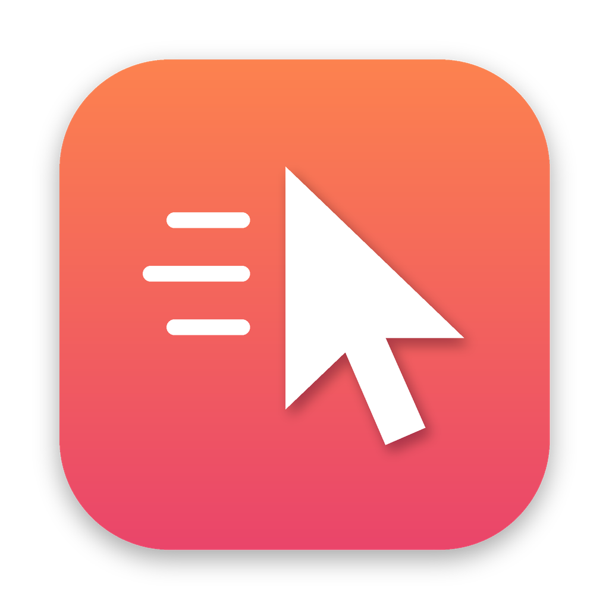

<p align="center"></p>

<h1 align="center">Fidget</h1>

<p align="center">Garde ton Mac éveillé et ton statut au vert en bougeant la souris quand tu t'absentes.</p>

<p align="center"><a href="README.md">Read in English</a></p>

Fidget vit dans la barre de menus. Quand tu n'as pas touché la souris ni le clavier depuis un moment, il déplace le curseur d'un pixel puis le remet en place (ou, en mode zen, envoie un mouvement invisible à l'œil). Teams, Slack et compagnie continuent de t'afficher disponible, et l'écran ne se met jamais en veille. Pendant que tu travailles, il ne fait rien du tout.

Il existe en deux versions qui partagent les mêmes réglages : une app de barre de menus et un outil en ligne de commande `fidget`.

## Installation

Avec Homebrew :

```sh
brew install --cask sachsa/tap/fidget   # app barre de menus
brew install sachsa/tap/fidget          # outil en ligne de commande
```

Ou télécharge `Fidget-x.y.z.zip` depuis la [dernière release](https://github.com/SachsA/fidget/releases/latest) et glisse `Fidget.app` dans Applications.

Fidget n'est pas encore notarisé, donc Gatekeeper bloque le premier lancement : ouvre Réglages Système > Confidentialité et sécurité et clique sur « Ouvrir quand même ». Accorde ensuite l'accès Accessibilité quand il est demandé (Réglages Système > Confidentialité et sécurité > Accessibilité). Sans lui, macOS ignore silencieusement les mouvements simulés.

Nécessite macOS 13 Ventura ou plus récent. Binaire universel (Apple silicon et Intel).

## Fonctionnalités

| Réglage | Effet |
| --- | --- |
| Nudge after | Délai d'inactivité avant un mouvement (15 s à 4 min dans l'app, 5 s à 1 h en CLI) |
| Movement | Visible (déplace de 1 à 50 px puis revient) ou Zen (le curseur ne bouge pas) |
| Keep the display awake | Empêche la veille de l'écran et du Mac tant que Fidget est actif |
| Schedule | Actif seulement certains jours et heures, par exemple du lundi au vendredi de 09:00 à 18:00. Les plages de nuit fonctionnent aussi |
| Launch at login | Lance Fidget à l'ouverture de session |
| Keyboard shortcut | Active ou coupe Fidget depuis n'importe où (⌃⌥⌘J par défaut, personnalisable) |

L'icône de la barre de menus indique l'état : actif, en pause, hors plage horaire (lune) ou en attente de permission (panneau d'alerte).

## Ligne de commande

```sh
fidget                         # lance au premier plan avec tes réglages
fidget -i 30 --zen             # surcharge pour ce lancement : 30 s, mouvement invisible
fidget config                  # affiche les réglages
fidget config set interval 120
fidget config set days mon-fri
fidget config set hours 09:00-18:00
fidget config set schedule on
fidget config reset
fidget jiggle                  # un mouvement, tout de suite
fidget --help
```

Les réglages sont stockés dans `~/Library/Preferences/io.github.sachsa.fidget.plist` et partagés avec l'app : un `fidget config set` est pris en compte en direct par Fidget.app s'il tourne.

Le CLI a besoin de l'accès Accessibilité pour le terminal qui le lance (Terminal, iTerm, Ghostty...).

## Compiler depuis les sources

```sh
swift build                 # build debug
swift test                  # tests unitaires
swift run fidget --help
scripts/build.sh 1.2.3      # build release universel : dist/Fidget.app + archives
```

Définis `CODESIGN_IDENTITY` avec une identité « Developer ID Application » pour signer proprement ; sinon le build est signé ad hoc.

Le code est découpé en trois targets : `FidgetCore` (réglages, plages horaires, moteur), `fidget` (CLI) et `FidgetApp` (app SwiftUI de barre de menus). Aucune dépendance externe.

## Publier une version

Pousse un tag `vX.Y.Z`. Le workflow de release teste, compile, publie la release GitHub et, si le secret `TAP_TOKEN` est défini (un token avec accès en écriture à `SachsA/homebrew-tap`), met à jour la formule et le cask Homebrew.

## Dépannage

**Le curseur ne bouge pas.** Vérifie l'accès Accessibilité. Après une mise à jour, un build signé ad hoc est vu comme une nouvelle app par macOS : retire Fidget de la liste Accessibilité avec le bouton moins, puis ajoute-le à nouveau.

**Teams m'affiche quand même absent.** Utilise le mode visible avec un délai court (Teams passe en absent après environ 5 minutes d'inactivité).

**Pourquoi pas le Mac App Store ?** Les apps de l'App Store doivent être sandboxées, et le sandbox interdit de simuler des événements souris.

## Licence

MIT
