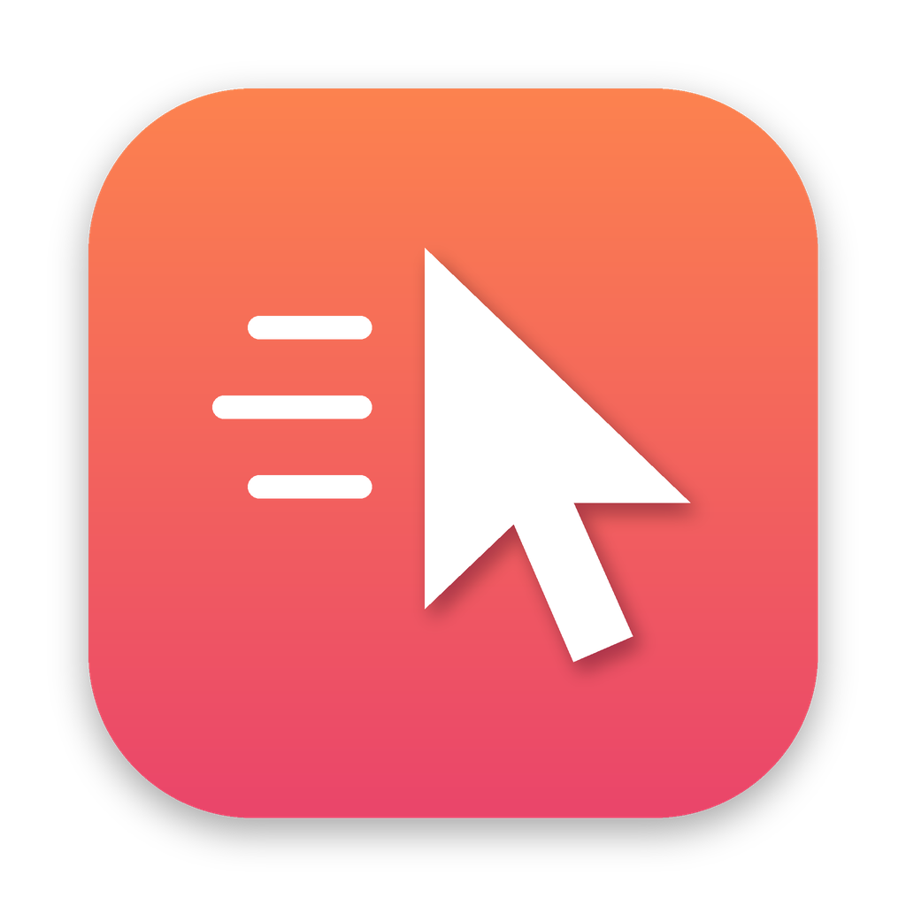

<p align="center"></p>

<h1 align="center">Fidget</h1>

<p align="center">Keeps your Mac awake and your status green by nudging the mouse when you step away.</p>

<p align="center"><a href="README.fr.md">Lire en français</a></p>

Fidget lives in your menu bar. When you have not touched the mouse or keyboard for a while, it moves the cursor by a pixel and back (or, in zen mode, sends a movement the eye cannot see). Teams, Slack and friends keep showing you as available, and the screen never goes to sleep. While you are working, it does nothing at all.

It comes in two flavours that share the same settings: a menu bar app and a `fidget` command line tool.

## Install

With Homebrew:

```sh
brew install --cask sachsa/tap/fidget   # menu bar app
brew install sachsa/tap/fidget          # command line tool
```

Or download `Fidget-x.y.z.zip` from the [latest release](https://github.com/SachsA/fidget/releases/latest) and drag `Fidget.app` to Applications.

Fidget is not notarized yet, so the first launch is blocked by Gatekeeper: open System Settings > Privacy & Security and click "Open Anyway". Then grant Accessibility access when prompted (System Settings > Privacy & Security > Accessibility). Without it macOS silently ignores the simulated mouse events.

Requires macOS 13 Ventura or later. Universal binary (Apple silicon and Intel).

## Features

| Setting | What it does |
| --- | --- |
| Nudge after | Inactivity delay before a nudge (15 s to 4 min in the app, 5 s to 1 h from the CLI) |
| Movement | Visible (moves 1 to 50 px and back) or Zen (the cursor stays still) |
| Keep the display awake | Prevents display and system sleep while Fidget is active |
| Schedule | Only run on some days and hours, e.g. Monday to Friday, 09:00 to 18:00. Overnight ranges work too |
| Launch at login | Starts Fidget when you log in |
| Keyboard shortcut | Toggles Fidget from anywhere (default ⌃⌥⌘J, recordable) |

The menu bar icon shows the current state: active, paused, outside schedule (moon) or waiting for permission (warning sign).

## Command line

```sh
fidget                         # run in the foreground with your saved settings
fidget -i 30 --zen             # override for this run: 30 s, invisible movement
fidget config                  # show settings
fidget config set interval 120
fidget config set days mon-fri
fidget config set hours 09:00-18:00
fidget config set schedule on
fidget config reset
fidget jiggle                  # nudge once, right now
fidget --help
```

Settings live in `~/Library/Preferences/io.github.sachsa.fidget.plist` and are shared with the app: a `fidget config set` is picked up live by a running Fidget.app.

The CLI needs Accessibility access for the terminal it runs in (Terminal, iTerm, Ghostty...).

## Build from source

```sh
swift build                 # debug build
swift test                  # unit tests
swift run fidget --help
scripts/build.sh 1.2.3      # universal release build: dist/Fidget.app + archives
```

Set `CODESIGN_IDENTITY` to a "Developer ID Application" identity to sign properly; otherwise the build is ad-hoc signed.

The code is split in three targets: `FidgetCore` (settings, schedule, engine), `fidget` (CLI) and `FidgetApp` (SwiftUI menu bar app). No third-party dependencies.

## Releasing

Push a `vX.Y.Z` tag. The release workflow tests, builds, publishes the GitHub release and, if the `TAP_TOKEN` secret is set (a token with write access to `SachsA/homebrew-tap`), updates the Homebrew formula and cask.

## Troubleshooting

**The cursor does not move.** Check Accessibility access. After an update, an ad-hoc signed build counts as a new app for macOS: remove Fidget from the Accessibility list with the minus button, then add it again.

**Teams still shows me as away.** Use visible mode with a short delay (Teams switches to away after about 5 minutes of inactivity).

**Why not the Mac App Store?** App Store apps must be sandboxed, and the sandbox forbids simulating mouse events.

## License

MIT
